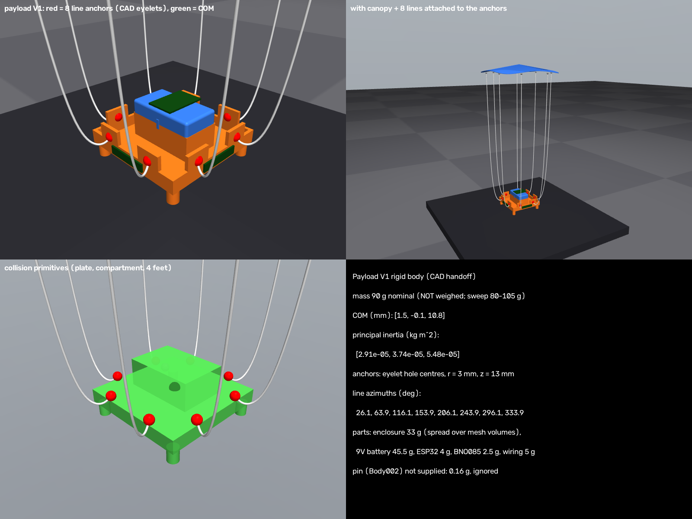
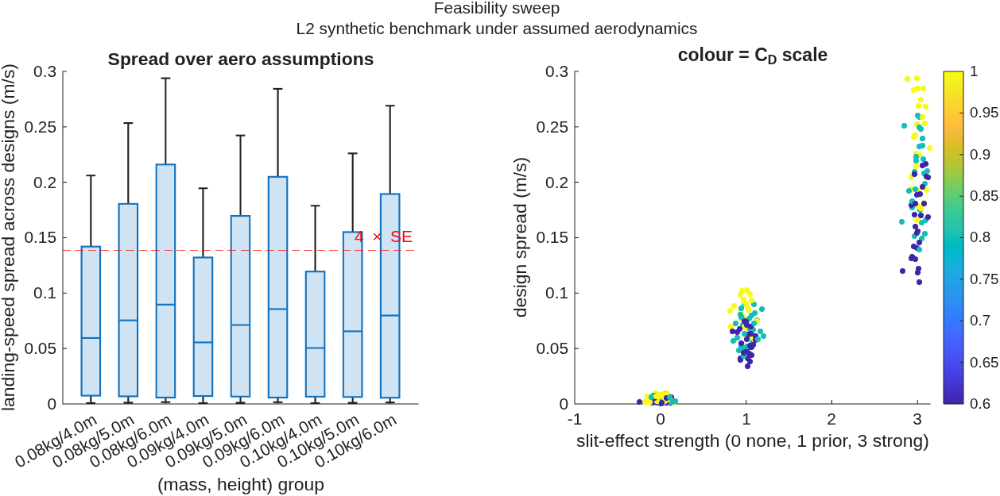
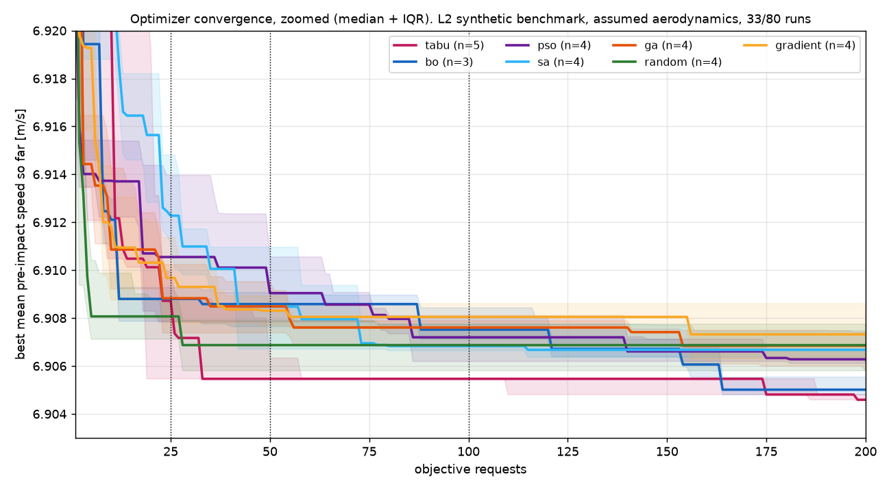
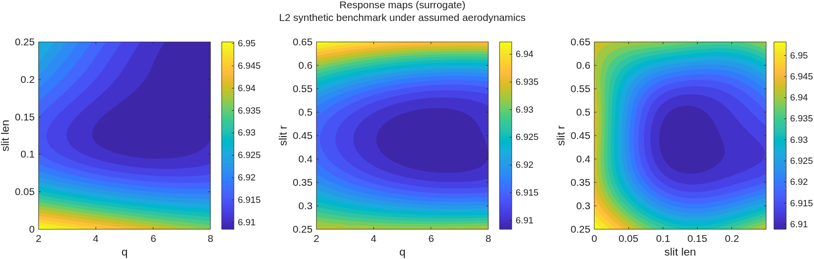

# Data-Driven Parachute Design — Simulation Phase Report

**Scope:** synthetic simulation phase (evidence levels **L1** and **L2** only). Rankings of *designs* below
reflect the heuristic aerodynamic prior (`prior-v1`), **not** real physics. Real design conclusions need
calibration (L3) and fresh physical drops (L4).

| Level | Meaning |
|---|---|
| L1 | software validation against known synthetic truth |
| L2 | synthetic benchmark under assumed aerodynamics |
| L3 | calibrated-model prediction (needs real drops) |
| L4 | physical demonstration (needs real drops) |

## 1. Payload V1 (from CAD)
Mass 0.09 kg nominal (not weighed), COM (m) [0.0015, -0.0001, 0.0108],
line azimuths (deg) [26.1, 63.9, 116.1, 153.9, 206.1, 243.9, 296.1, 333.9]. Anchors = eyelet hole centres from the mesh.

## 2. Feasibility (go/no-go, L2)
Decisions and full numbers: `results/DECISIONS.md`. Current config: 0.090 kg, 4 m drop.

| mass_kg | height_m | GroupCount | sum_resolvable |
|---|---|---|---|
| 0.08 | 4 | 27 | 8 |
| 0.08 | 5 | 27 | 9 |
| 0.08 | 6 | 27 | 9 |
| 0.09 | 4 | 27 | 6 |
| 0.09 | 5 | 27 | 9 |
| 0.09 | 6 | 27 | 9 |
| 0.105 | 4 | 27 | 6 |
| 0.105 | 5 | 27 | 9 |
| 0.105 | 6 | 27 | 9 |

| slitStrength | GroupCount | sum_resolvable |
|---|---|---|
| 0 | 81 | 0 |
| 1 | 81 | 0 |
| 3 | 81 | 74 |

**Reading:** with 3 repeats per design, design differences are only resolvable if slits have a strong
aerodynamic effect; under the prior-map or no-slit assumptions they are not.

## 3. Shared sensing pipeline (L1)
Single-drop validation against simulator truth (payload V1, 4 m): fused pre-impact speed error ≈ 0.04 m/s,
IMU-only ≈ 0.0001 m/s, camera-only ≈ 0.39 m/s (the camera sees only the last ~0.2 s; no markers fit on the
payload, so colour + depth tracking gives position only). Clock sync error ≈ 2 ms. All Python (pytest) and
MATLAB test suites pass (leakage, invalid handling, cache, budget accounting, determinism).

## 4. Timing / storage pilot
{
 "drops": 50,
 "workers": 12,
 "wall_s": 498.95849895477295,
 "drops_per_hour": 360.7514460161861,
 "t_sim_mean_s": 69.1908601808548,
 "t_est_mean_s": 40.4296586561203,
 "bundle_mb_mean": 167.20087053999998,
 "objective_status_counts": {
  "ok": 9,
  "infeasible_sensing": 1
 },
 "sensing_failure_scenarios": 3,
 "cpu_mhz_now": 500.04125000000005,
 "projection_full_benchmark": {
  "simulated_drops_upper_bound": 70000,
  "hours_at_pilot_rate": 194.03941626018945,
  "transient_disk_gb_per_worker": 0.16720087054,
  "retained_disk_gb_at_keep_fraction": 234.081218756
 }
}

## 5. Optimizer benchmark (L2) — 7 methods × 10 runs × max 200 evaluations × 5 scenarios
Progress: 33 of 80 (method, run) jobs completed (70 single-objective + 10 multi-objective); see table column 'runs'

| method | runs | best_median | best_iqr | best_at25 | best_at50 | best_at100 | best_at200 | evals_to_target_median | frac_reached_target | requests_median | unique_designs_median | simulated_drops_median | sensing_failure_rate | fresh_score_median |
|---|---|---|---|---|---|---|---|---|---|---|---|---|---|---|
| bo | 3 | 6.905 | 0.0011039 | 6.9088 | 6.9086 | 6.9075 | 6.905 | 160 | 0.66667 | 200 | 200 | 1000 | 0.12167 | 15.434 |
| ga | 4 | 6.9068 | 0.0021925 | 6.9088 | 6.9085 | 6.9076 | 6.9068 | 174 | 0.25 | 200 | 103.5 | 527.5 | 0.05375 | 6.8342 |
| gradient | 4 | 6.9073 | 0.0030214 | 6.9097 | 6.9083 | 6.908 | 6.9073 | nan | 0 | 200 | 200 | 1000 | 0.01875 | 6.844 |
| pso | 4 | 6.9063 | 0.00108 | 6.9105 | 6.909 | 6.9072 | 6.9063 | nan | 0 | 200 | 194.5 | 952.5 | 0.11 | 6.8232 |
| random | 4 | 6.9069 | 0.0021408 | 6.9081 | 6.9069 | 6.9069 | 6.9069 | 5 | 0.25 | 200 | 200 | 1000 | 0.1075 | 15.434 |
| sa | 4 | 6.9067 | 0.0016724 | 6.9123 | 6.9085 | 6.9068 | 6.9067 | nan | 0 | 200 | 200 | 930 | 0.1025 | 11.139 |
| tabu | 5 | 6.9046 | 0.00038196 | 6.9087 | 6.9055 | 6.9055 | 6.9046 | 142.5 | 0.8 | 200 | 200 | 320 | 0.031 | 6.8394 |

### Multi-objective (speed vs lateral speed)
| method | runs | best_median | hypervolume_median | spacing_median | requests_median |
|---|---|---|---|---|---|
| moo | 5 | 6.9062 | 0.074438 | 0.0039613 | 200 |

## 6. Representation studies
PCA (rich r(θ) encoding, 64 samples):

| k | var_retained_pct | recon_rmse | valid_rate |
|---|---|---|---|
| 2 | 60.7 | 0.0356 | 1 |
| 3 | 70 | 0.0311 | 1 |
| 4 | 79.2 | 0.0259 | 1 |
| 6 | 87.2 | 0.0203 | 1 |
| 8 | 92.4 | 0.0157 | 1 |
| 12 | 97.7 | 0.00852 | 1 |

Autoencoder (held-out test split):

| k | test_recon_rmse | valid_rate |
|---|---|---|
| 2 | 0.0316 | 1 |
| 3 | 0.0271 | 1 |
| 4 | 0.0247 | 1 |
| 6 | 0.0199 | 1 |
| 8 | 0.0154 | 1 |

VAE: VAE k=4: generated valid rate 1.000, diversity 0.342 (data 0.570)

Same search (BO), same budget, different representations (simulator + sensing pipeline, L2):

| representation | run | best_score | valid_geometry_rate | sensing_failure_rate | requests | simulated_drops |
|---|---|---|---|---|---|---|
| param3 | 1 | 6.85 | 1 | 0 | 50 | 0 |
| pca | 1 | 6.81 | 0.92 | 0.06 | 50 | 135 |
| autoencoder | 1 | 6.85 | 0.96 | 0.06 | 50 | 144 |
| vae | 1 | 6.87 | 1 | 0 | 50 | 150 |

## 7. Surrogates, sensitivity, flight-behaviour clusters (L2, benchmark data)
Leave-geometry-out cross-validation:

| model | rmse | mae | rank_corr |
|---|---|---|---|
| linear | 0.0154 | 0.0106 | 0.274 |
| quadratic | 0.012 | 0.00644 | 0.719 |
| gp | 0.0117 | 0.00601 | 0.726 |
| ensemble | 0.0117 | 0.00595 | 0.755 |

Sobol indices (GP surrogate):

| var | first | total |
|---|---|---|
| q | 0.0811 | 0.0922 |
| slit_len | 0.472 | 0.511 |
| slit_r | 0.412 | 0.442 |

k-means centroids of measured flight features:

| preimpact_vz | lateral_speed | landing_offset | tilt_rms_deg | tilt_max_deg | swing_rate_rms | peak_specific_force_g |
|---|---|---|---|---|---|---|
| 7.04 | 0.945 | 0.223 | 8.01 | 10.3 | 0.478 | 12.9 |
| 6.87 | 0.145 | 0.119 | 10.7 | 15.7 | 0.685 | 12.8 |
| 6.91 | 0.143 | 0.0974 | 6.44 | 9.8 | 0.371 | 12.8 |

## 8. Real2sim infrastructure (validated synthetically, L1)
| mismatch | rmse_mps | bias_mps | maxabs_mps | rank_corr |
|---|---|---|---|---|
| none | 0.0764 | 0.0386 | 0.137 | 0.6 |
| logistic_opening | 0.0668 | 0.0285 | 0.124 | 0.657 |
| drag_exponent_1.8 | 0.0712 | -0.0342 | 0.126 | 0.657 |
| velocity_porosity | 0.0634 | 0.00174 | 0.101 | 0.657 |
| line_elasticity | 0.072 | 0.0166 | 0.111 | 0.314 |
| bias_drift | 0.108 | 0.0875 | 0.208 | 0.886 |

Parameter recovery note: in a 4 m drop, K_open and the opening time τ are ~0.99 correlated, so only their
combination is identifiable from height data; fix τ from video and fit the effective drag area.

## 9. Designs for the real drop test
### Real drop test: which designs to build and drop

Simulation (L2, assumed aerodynamics) picked one design. In the 33 completed benchmark runs it was found
independently by 5 runs of 3 different methods (tabu 1, GA 2, PSO 2-4). On the 5 search scenarios it
scores **6.905 m/s, against about 6.94 m/s for near-circular unslit designs** (a gap of about 0.035 m/s, about 0.5%).
It also held up on 20 fresh scenarios (6.821 m/s; the fresh scenarios are a different set, so compare only within one set).
The real test asks whether that holds, and *why*: is it the shape, the slits, or both?

#### The 4 designs (2 x 2: shape x slits). Every canopy has exactly 250 cm² of plastic

| Code | Design | q | slit length (x R_eq) | slit radius (x R_eq) | What it tests |
|---|---|---|---|---|---|
| **A** | **Winner**: rounded square + 4 slits | 8 | 0.15 | 0.45 | the optimised design |
| B | rounded square, no slits | 8 | 0 | n/a | shape effect alone |
| C | circle + the same 4 slits | 2 | 0.15 | 0.45 | slit effect alone |
| D | circle, no slits (baseline, = DOE design 17) | 2 | 0 | n/a | reference |

Templates (1:1, print at 100% and check the 50 mm scale bar): `A_winner_q8_slits.svg`,
`B_square_noslits.svg`, `C_circle_slits.svg`, `D_circle_baseline.svg`. Black = outline cut, red = slit cuts
(knife cuts, no material removed). The square canopies are 160 mm across and the circles 178 mm.

#### Drops
* 32 drops = 8 blocks x 4 designs, randomised within each block: `real_drop_schedule.csv`. Follow the order.
* Same setup as the simulator: 4.0 m release height, payload V1, 8 lines; full procedure in `../doe/DROP_DAY_PROTOCOL.md`.
* Record every drop, including failed ones, in the `notes` column. Never redo a bad drop silently.

#### How to read the result
* A slower than D, in the 4 m pre-impact speed from the shared sensing pipeline, means the optimised design really helps (L4).
* Compare B and C with D to separate the shape effect from the slit effect.
* The predicted gap is small, about 0.035 m/s. With 8 drops per design the standard error of a mean is about sd/2.8.
  A gap this size is only detectable if real drop-to-drop scatter is below about 0.05 m/s. Check the scatter after the first 2 blocks
  and add blocks if needed. If real slits have a stronger effect than assumed (the feasibility sweep's "strong" case), the gap is larger.
* q = 8 is the upper limit of the search range, so the true optimum may be even squarer. If A wins clearly, a
  follow-up with q > 8 is worthwhile.
* Optional, for calibrating the simulator (L3): the 18-design DOE in `../doe/` (54 drops).

## 10. DOE and fabrication
18 designs (16 LHS + 2 unslit baselines), 54-drop randomized schedule (`results/doe/drop_schedule.csv`),
1:1 cutting templates (`results/doe/templates/`). The fabrication-gap comparison (L4) requires real drops.

## 11. Known limitations
* `prior-v1` aerodynamics are assumed; slits do not open in the rigid simulated canopy.
* Mass, line length, canopy mass and RealSense model are placeholders; contact model not yet calibrated.
* RGB regeneration matches up to small GPU rasterization differences; metrics agree.
* Part of the benchmark ran on a rented server (vast.ai): laptop GPU, server GPU (EGL) and server CPU (OSMesa) rendering.
  Remote vs local drops gave identical metrics. OSMesa vs GPU differed by ~0.0006 m/s, far below the 0.04 m/s pipeline noise.
  The backend is recorded in every drop manifest.
* Benchmark incomplete: runs per method are in the table (n); the remaining runs resume with `scripts/run_jobs.sh`.
